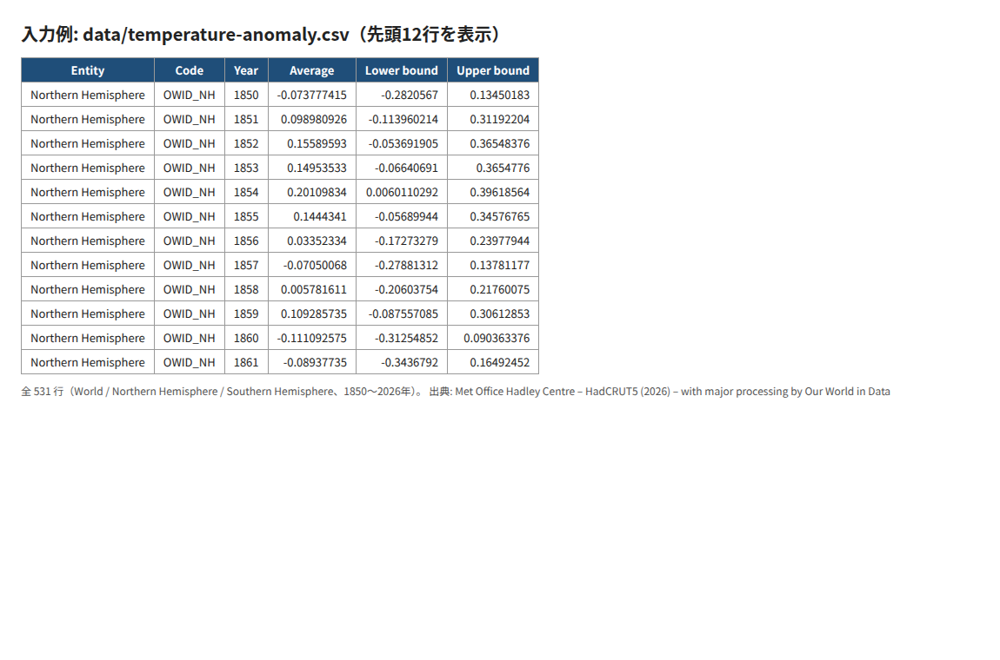
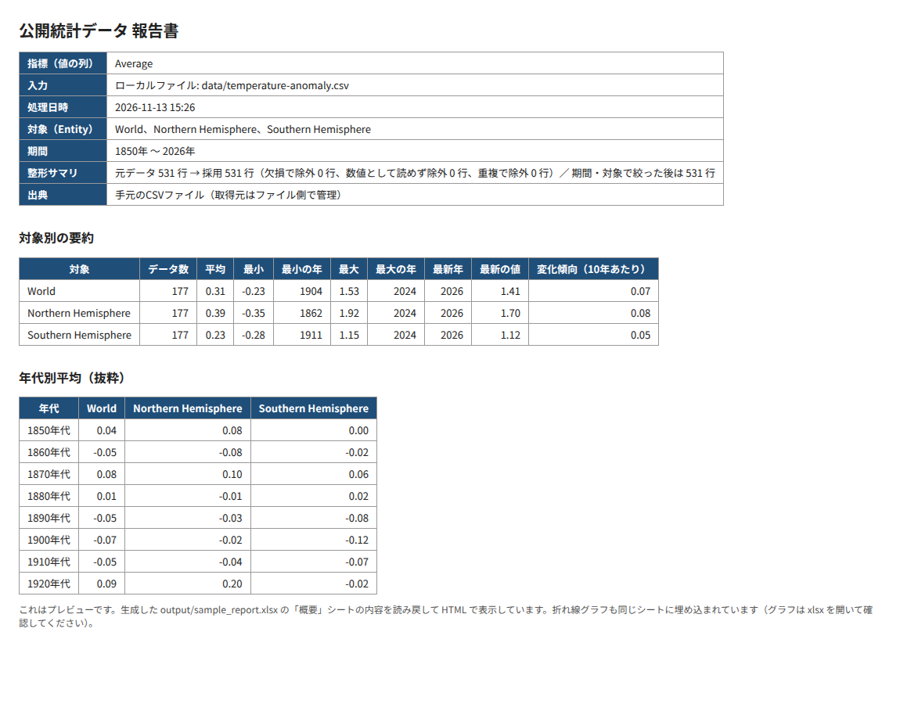

# サンプル① 公開統計データ → Excel報告書ツール

公開されている統計データ（CSV）を取得し、整形して、表とグラフ入りの Excel 報告書（.xlsx）を出力する Python ツールです。

同梱のデータでは「世界の年平均気温の偏差（1850〜2026年、世界・北半球・南半球）」を題材に、対象別の要約（平均・最小・最大・最新の値・変化傾向）と年代別平均を集計し、年次推移の折れ線グラフを付けた報告書を作ります。

## できること

- 入力は2通り: 取得先の URL から CSV を取得する / 手元の CSV ファイルを指定する
- 対象（Entity）と期間（開始年・終了年）を引数で指定できる
- 整形: 前後の空白の除去、欠損行・数値として読めない行・重複行の除外（除外した件数は報告書と画面に残る）
- 出力 xlsx の構成
  - 「概要」シート: 出典・処理条件・整形サマリ、対象別の要約表、年代別平均の表、折れ線グラフ（年次推移）
  - 「データ」シート: 整形後の年別データ（年 × 対象の表）
- 失敗したとき（ファイルが無い、CSV が壊れている、必要な列が足りない、条件に合うデータが0件など）は、原因が分かる日本語のメッセージを出して終了します（終了コード 1）

想定する入力形式は、`Entity, Code, Year, 値...` のような年次データの CSV です。値として使う列は自動で判定します（`--value-column` で明示も可能）。

## 実行方法

前提: Python 3.14（確認した環境）。プロジェクト直下に仮想環境を作り、openpyxl を入れます。**この手順どおりに初めから実行できます。**

```bash
# 1) プロジェクト直下で仮想環境を作り、openpyxl を入れる（初回だけ）
cd ~/Documents/get_work
python3 -m venv .venv
.venv/bin/pip install openpyxl

# 2) 同梱CSVから報告書を作る（ファイル入力モード）
.venv/bin/python samples/stats-excel-report/stats_excel_report.py \
  --csv samples/stats-excel-report/data/temperature-anomaly.csv \
  --out samples/stats-excel-report/output/sample_report.xlsx

# 3) URLから取得して作る（URL取得モード。対象と期間を指定した例）
.venv/bin/python samples/stats-excel-report/stats_excel_report.py \
  --entities World --start-year 1950 \
  --out samples/stats-excel-report/output/report_url.xlsx
```

成功すると、入力・整形サマリ・出力先が画面に表示され、指定した場所に .xlsx ができます。

### 引数

| 引数 | 既定値 | 説明 |
|---|---|---|
| `--url` | Our World in Data の気温偏差CSV（下記） | 取得先 CSV の URL。`--csv` 指定時は使いません |
| `--csv` | なし | 手元の CSV ファイルを使う場合に指定 |
| `--entities` | `World,Northern Hemisphere,Southern Hemisphere` | 対象をカンマ区切りで指定 |
| `--start-year` / `--end-year` | 制限なし | 期間を年で指定（含む） |
| `--value-column` | 自動判定 | 値として使う列名 |
| `--out` | `report.xlsx` | 出力先の .xlsx パス |
| `--verbose` | オフ | エラー時に詳しい例外を表示 |

## 入力例

同梱のテスト用入力データ `data/temperature-anomaly.csv`（取得した実データ、そのまま）:



全531行（3対象 × 1850〜2026年）。列は Entity / Code / Year / Average（値）/ Lower bound / Upper bound で、このツールは Average 列を値として使います。

## 出力例

生成した `output/sample_report.xlsx` の「概要」シートの内容を読み戻して HTML で表示した**プレビュー**です（この環境には LibreOffice が無いため、xlsx のスクリーンショットそのものではありません。折れ線グラフも同じシートに埋め込まれています）:



## データ取得先・出典・ライセンス

- 取得先: Our World in Data の Chart Data（CSV）
  - URL: https://ourworldindata.org/grapher/temperature-anomaly.csv
  - 内容: 世界・南北半球の年平均気温偏差（1850〜2026年、取得日時点の公開データそのまま）
  - 出典表記（データ提供元の指定どおり）: **Met Office Hadley Centre – HadCRUT5 (2026) – with major processing by Our World in Data**
- 再利用条件の確認（確認日: **2026-11-13**）
  - Our World in Data 公式の利用案内 https://ourworldindata.org/how-to-use-our-world-in-data を開いて確認した。要点: Our World in Data が作成したデータは **CC BY** ライセンスで、出典を表示すれば利用・複製・配布ができる。ただし第三者から提供されたデータは提供元の条件に従う必要があり、引用の際は Our World in Data と元のデータ提供元の両方を明記するよう求められている。本サンプルでは上記の出典表記をこの README に明記している。報告書（Excel）の出典欄には、取得元URL（ファイルから入力した場合はその旨の定型文）を記録する。
  - robots.txt の確認（2026-11-13）: https://ourworldindata.org/robots.txt の全内容は Sitemap の指定のみで、User-agent / Disallow による取得制限の記載はなかった。実際の取得は通常の HTTP GET で1回だけ行った。
- 第一候補だった気象庁について: 「過去の気象データ・ダウンロード」は地点・期間を選ぶ対話式フォームから送信して CSV を得る方式で、登録なしに直接 GET できる CSV の URL を確認できなかったため、本サンプルでは採用しなかった（e-Stat の CSV 直接取得は今回未検証）。

## 検証したこと（2026-11-13、pol-linux 上で実施）

- README の手順どおり仮想環境を作り直し、ファイル入力モードと URL 取得モードの両方で実行して .xlsx が生成されることを確認した
- 生成した xlsx をプログラムで開き、「概要」「データ」の2シートと、概要シート内の折れ線グラフ（LineChart）1つの存在を確認した
- 異常系を確認した: ファイルが無い／空ファイル／ヘッダーのみ／必要な列が無い／壊れた CSV／全行が欠損・非数値／期間指定で0件／存在しない対象／HTTP 404 の URL。いずれも traceback ではなく日本語のメッセージで終了コード 1 になることを確認した
- コードに認証情報は含まれていない（そもそも認証が不要な公開データのみを対象にしている）

## 想定する案件像

分野C（データ整形・Excel自動化）の提案に貼る想定のサンプルです。「公開データや手元の CSV を、整形してグラフ付きの Excel 報告書にするところまで自動化できます」という提案の実物として使います。
